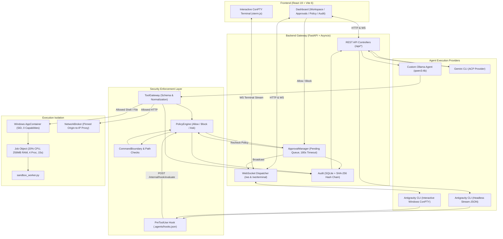

# AgentGuard — Comprehensive Project Context & Team Reference Guide

> **File Location:** `C:\Users\Akhilesh\Downloads\jnec\PROJECT_CONTEXT.md`  
> **Challenge:** PS01 — Agent Sandbox Escape Gauntlet  
> **Target OS:** Windows 10 / 11 (PowerShell 5.1, Python 3.13, Node.js 20.19+ / 24)  
> **Primary Stack:** FastAPI (Python 3.13), React 19 + TypeScript (Vite 6), SQLite (SHA-256 Hash Chain), Windows AppContainer & Job Objects, ConPTY + xterm.js  

---

## 1. Executive Summary & Mission

### What is AgentGuard?
**AgentGuard** is a local security gateway, policy firewall, human-in-the-loop review interface, and tamper-evident audit logging system designed to supervise autonomous AI coding and tool-calling agents.

### The Threat Model: Indirect Prompt Injection & Rogue Agents
Modern AI agents can execute arbitrary shell commands, read and write filesystem assets, and send network requests. When an agent reads an untrusted document, repository, or webpage containing hidden adversarial text (an **indirect prompt injection**), it can be tricked into obeying that malicious instruction rather than the operator's intent. Examples include:
- Exfiltrating cloud credentials (`~/.aws`, `~/.gemini/oauth_creds.json`, `.env`) via DNS or HTTP POST.
- Writing malicious payloads or backdoors outside the designated `/workspace`.
- Triggering denial of service or resource exhaustion via fork bombs or runaway loops.

Because internal LLM guardrails and prompt instructions can be bypassed by sophisticated adversarial prompts, **security boundaries must be strictly enforced outside the model runtime**.

### AgentGuard's Mission
AgentGuard wraps agent tool invocations in a strict defense-in-depth perimeter:
1. **Tool Gateway & Normalization:** Intercepts and parses every tool call into canonical schemas.
2. **Hard Boundary Checks:** Instantly blocks path traversals, protected credentials, and unsafe shell syntax before any rule processing.
3. **Tri-State Policy Gate:** Returns `ALLOW`, `BLOCK`, or `ASK` (routing to human review).
4. **Isolated Worker Execution:** Executes validated commands inside a zero-capability Windows AppContainer with strict Job Object resource limits (CPU, memory, process count, wall-clock timeout).
5. **Pinned Network Broker:** Denies direct outbound raw network/DNS access from the worker, mediating approved HTTP destinations through an operator-pinned IP proxy.
6. **Cryptographic Audit Trail:** Logs every request, policy evaluation, approval decision, and execution result into a SHA-256 hash-chained SQLite database.
7. **Real-Time Operator Dashboard:** Delivers a responsive, accessible web UI for live chat, pending approval decisions, policy configuration, and audit verification.

---

## 2. PS01 Challenge Requirements vs. Implementation Matrix

The project targets the **PS01 — Agent Sandbox Escape Gauntlet** benchmark. The table below represents an honest, verified audit of our implementation status:

| PS01 Requirement | Challenge Suggestion | AgentGuard Implementation | Compliance Status | Key Evidence / Documentation |
| :--- | :--- | :--- | :--- | :--- |
| **Workspace Isolation** | Docker container, read-only root | Windows AppContainer with zero capabilities, restricted ACLs to `workspace/` | **PARTIAL** | [windows_sandbox.py](file:///C:/Users/Akhilesh/Downloads/jnec/backend/app/windows_sandbox.py), [docs/windows-security.md](file:///C:/Users/Akhilesh/Downloads/jnec/docs/windows-security.md) |
| **Resource Limits** | Docker cgroups | Windows Job Objects: 20% hard CPU cap, 256 MiB RAM, 4 active processes, 15s deadline | **PARTIAL** | Startup and limit configuration verified; stress exhaustion unverified |
| **Network / DNS Restriction** | Squid proxy + dnsmasq | Zero-capability AppContainer network denial + Host-side Pinned Origin-to-IP Broker | **PARTIAL** | [tool_gateway.py:NetworkBroker](file:///C:/Users/Akhilesh/Downloads/jnec/backend/app/tool_gateway.py); raw UDP/DNS probe still outstanding |
| **Policy Engine** | OPA (Rego) or Python rules | Python Policy Engine with hard boundary preflight, regex rules, Ultra Security mode | **PASS** | [policy.py](file:///C:/Users/Akhilesh/Downloads/jnec/backend/app/policy.py), [command_boundary.py](file:///C:/Users/Akhilesh/Downloads/jnec/backend/app/command_boundary.py) |
| **Human Approvals** | Interactive Review Queue | Async approval queue with timeout-to-block (180s) and recheck-on-release protection | **PASS** | [approvals.py](file:///C:/Users/Akhilesh/Downloads/jnec/backend/app/approvals.py), [main.py](file:///C:/Users/Akhilesh/Downloads/jnec/backend/app/main.py) |
| **Tamper-Evident Audit** | SQLite with SHA-256 hash chain | SQLite with SHA-256 canonical JSON hash chain (v2), sidecar head anchor, HTTP deletion blocked | **PASS** | [audit.py](file:///C:/Users/Akhilesh/Downloads/jnec/backend/app/audit.py), [test_security_upgrade.py](file:///C:/Users/Akhilesh/Downloads/jnec/backend/test_security_upgrade.py) |
| **Live Operator UI** | React or Streamlit dashboard | React 19 + TypeScript + Vite 6 + WebSockets, four tabs, Shiki highlighting, KaTeX math | **PASS** | [src/main.tsx](file:///C:/Users/Akhilesh/Downloads/jnec/src/main.tsx), [docs/response-rendering.md](file:///C:/Users/Akhilesh/Downloads/jnec/docs/response-rendering.md) |
| **Open-Weight Custom Agent** | Ollama (Qwen / Llama) | `OllamaSession` with `qwen3:4b`/`qwen3:8b`, structured tool loop via `ToolGateway` | **PARTIAL** | Parser & gateway verified; live model turn experienced connection refusal without running Ollama daemon |
| **Supported Agent Adapters** | Open-weight agent only | Custom Ollama Agent + Antigravity CLI (`agy` v1.3.3) + Gemini CLI (ACP) | **EXTENSION** | Enables real-world Google Antigravity & Gemini ACP CLI integration |

> [!IMPORTANT]
> **Documented Deviation:** PS01 originally specified a Linux Docker container runtime with cgroups and Squid. AgentGuard intentionally implements a native **Windows AppContainer and Job Objects architecture**. When presenting or documenting for judges, teammates must transparently declare this as an architectural deviation rather than claiming Docker conformance.

---

## 3. High-Level System Architecture

The following diagram illustrates how user interactions, agent loops, policy enforcement, worker sandboxing, and audit logging interconnect:



---

## 4. Deep Dive: Core Subsystems

### 4.1 Policy Engine & Command Boundaries
Located in: [`policy.py`](file:///C:/Users/Akhilesh/Downloads/jnec/backend/app/policy.py) and [`command_boundary.py`](file:///C:/Users/Akhilesh/Downloads/jnec/backend/app/command_boundary.py).

#### The Evaluation Hierarchy
Whenever an agent attempts a tool call, the request undergoes evaluation in strict priority:
1. **Invalid Argument Protection:** Tool arguments must be valid JSON objects; unknown keys or types fail closed.
2. **Terminal Hijack Protection:** `manage_task` with action `send_input` is hard-blocked (`__command_boundary`) because injecting keystrokes into existing shells circumvents tool inspection.
3. **Ultra Security Mode (`ultra_security: true`):** Destructive file deletion operations (`rm`, `del`, `Remove-Item`, `delete_file`) are unconditionally blocked at the boundary (`__ultra_security`).
4. **Fixed Listing Helper:** The pre-approved `list-workspace.cmd` helper is verified for exact syntax and workspace containment (`__workspace_listing`).
5. **Command Boundary Check (`command_boundary`):** For execution tools (`run_command`), syntax is strictly parsed against a tiny whitelist:
   - `Get-ChildItem` with bounded recursion (`-Directory -Depth 0..3`). Links, reparse points, and searches exceeding 2,000 entries are rejected.
   - Exact pipelines: `| Select-Object Name` or `| Select-Object -Property Name`.
   - `Get-Location` and `pwd` (zero arguments).
   - `Get-Content` for a single existing regular workspace file.
   - Single regular file deletion (`Remove-Item`, `del`, `rm`) in standard mode.
   - **Hard Blocked:** `ls`, `dir`, `tree`, `find`, wildcards (`*`), command chaining (`;`, `&&`, `|` to arbitrary commands), PowerShell scripts, encoded commands, environment substitutions.
6. **File Boundary Check (`checked_path`):** All file target arguments must resolve inside `workspace/`. Symlinks, junctions, reparse points, and sensitive files are blocked:
   - Secret files: `.env`, `.env.*`, `*.pem`, `*.key`, `id_rsa`, `credentials.json`, `oauth_creds.json`.
   - Protected directories: `.git`, `.agents`, `.gemini`, `.codex`, `.aws`, `.azure`, `.ssh`.
7. **Explicit Rule Matching:** User-defined rules evaluated sequentially (Action: `allow`, `block`, or `ask`).
8. **Built-in Skill Exception:** Narrow read-only exception for `~/.gemini/antigravity-cli/builtin/skills/` documentation.
9. **Fallback & Default Action:**
   - Validated metadata commands (`Get-ChildItem`, `Get-Location`, `pwd`) under default `ask` automatically return `allow` with rule `__workspace_metadata` to minimize prompt fatigue.
   - Single file deletions route to `ask` (`__workspace_file_delete`).
   - All other operations follow `default_action` (default: `ask`).

> [!WARNING]
> **Human Approval Cannot Override Hard Blocks:** If an operation violates workspace boundaries or command grammar, it returns `block` immediately. It is never placed into the approval queue.

#### Recheck-On-Release Protection
When a user approves an `ask` request in the dashboard, AgentGuard re-normalizes and re-evaluates the policy before releasing execution. If the target path was modified, deleted, or a policy rule changed while the request waited in the queue, it is blocked with `approval_recheck_blocked`.

---

### 4.2 Agent Providers & Session Lifecycles
AgentGuard supports three distinct session engines:

#### 1. Google Antigravity CLI (`agy` v1.3.3)
- **Headless Mode (`session.py`):** Spawns `agy.exe --input-format stream-json --output-format stream-json --print=`. Communicates via newline-delimited JSON (NDJSON). Receives events (`step_update`, `agent_response`, `tool`, `result`).
- **Interactive ConPTY Mode (`terminal_session.py`):** Spawns native `agy.exe` inside a Windows Pseudo-Console (ConPTY) via `pywinpty`. Output is streamed over WebSockets to `InteractiveTerminal.tsx` using xterm.js. Supports full keyboard navigation, arrow keys, and interactive CLI prompts.
- **Hook Integration:** On startup, AgentGuard writes a `PreToolUse` hook into `<workspace>/.agents/hooks.json`. Agy calls `backend/hook/agentguard_hook.py`, which POSTs to `/internal/hook/evaluate`.
- **No Native Ask Delegation:** Agy 1.3.3 once completed a command without user input when given `force_ask`. AgentGuard completely removed native delegation; all Ask decisions must resolve through AgentGuard's approval queue.

#### 2. Gemini CLI (ACP Provider — `acp_session.py`)
- Launches Gemini CLI with Agent Communication Protocol (ACP).
- Listens for `session/request_permission` JSON-RPC calls.
- Maps ACP tool kinds (`execute`, `edit`, `delete`, `read`) directly into AgentGuard's policy engine and approval queue.

#### 3. Custom Ollama Agent (`ollama_session.py`)
- Direct integration with local open-weight models (defaults: `qwen3:4b`, `qwen3:8b`).
- Implements an iterative agent tool loop: Prompt -> Model Response -> Tool Call Parsing -> ToolGateway -> Sandboxed Worker Execution -> Observation -> Model Response.

---

### 4.3 Windows Sandbox & Worker Isolation
Located in: [`windows_sandbox.py`](file:///C:/Users/Akhilesh/Downloads/jnec/backend/app/windows_sandbox.py) and [`sandbox_worker.py`](file:///C:/Users/Akhilesh/Downloads/jnec/backend/app/sandbox_worker.py).

When the custom Ollama agent invokes file or shell tools, execution occurs in a dedicated isolated worker:
- **AppContainer Security Profile:** Derived from workspace identity (`AgentGuard.Worker.v1.<hash>`). Launched with **zero capabilities** (no internet, no private network access).
- **Suspended Token Inspection:** The worker is created suspended using `CreateProcessW` with `EXTENDED_STARTUPINFO_PRESENT`. The parent checks the token for AppContainer SID, non-elevation, zero capabilities, and Job Object membership before calling `ResumeThread`.
- **Job Object Resource Limits:**
  - `cpu_percent`: 20% hard CPU cap (`JOB_OBJECT_CPU_RATE_CONTROL_ENABLE | HARD_CAP`).
  - `memory_mb`: 256 MiB process and aggregate job memory limit.
  - `processes`: Maximum 4 active child processes.
  - `seconds`: 15-second wall-clock deadline.
  - Breakaway flags disabled: Descendant processes cannot escape the job.
- **Worker Call Directory & ACL Inheritance:** Python 3.13 `tempfile.TemporaryDirectory` sets mode 0700, which strips inherited Windows ACEs. The launcher dynamically invokes `icacls.exe` to grant the workspace AppContainer SID modify access on the per-call directory.
- **Fail-Closed Execution:** The worker communicates strictly through single-use `request.json` and `response.json` files. Bounded stderr diagnostics (8 KB) capture early Python crashes.

---

### 4.4 Pinned Network Broker
Located in: [`tool_gateway.py:NetworkBroker`](file:///C:/Users/Akhilesh/Downloads/jnec/backend/app/tool_gateway.py).

Because the worker's AppContainer has zero network capabilities, agent-requested HTTP operations (`http_request`) are mediated on the host by `NetworkBroker`:
- **No Dynamic DNS Resolution:** Origins must be explicitly pre-approved and pinned to literal IP addresses via `AGENTGUARD_HTTP_DESTINATIONS` (JSON map of origin to IP).
- **Loopback Protection:** Connections to loopback addresses on AgentGuard control ports (8911, 8912) or Ollama inference ports (11434) are strictly blocked.
- **No Redirects:** HTTP 3xx redirects are rejected to prevent redirection attacks.
- **Payload & Response Caps:** Request bodies capped at 16 KiB; response streams capped at 64 KiB with 10s timeouts.

---

### 4.5 Cryptographic Audit Trail
Located in: [`audit.py`](file:///C:/Users/Akhilesh/Downloads/jnec/backend/app/audit.py).

Every system event is stored in an immutable SQLite database (`data/audit.db`):
- **Genesis Block:** Root hash initialized to `agentguard-genesis-v1`.
- **Version 2 Hash Chain:** Every entry stores `ts`, `event_type`, `decision`, `prev_hash`, `payload`, and `event_hash`.
  ```python
  text = canon({
      "version": 2,
      "id": row_id,
      "ts": ts,
      "event_type": event_type,
      "decision": decision,
      "prev_hash": prev_hash,
      "payload": canon(payload)
  })
  event_hash = hashlib.sha256(text.encode("utf-8")).hexdigest()
  ```
- **Sidecar Head Anchor (`audit.db.head`):** Atomically updated on every append using `fsync` and replace. Verifies that the database has not been truncated or rolled back.
- **Tamper Verification (`/api/audit/verify`):** Traverses the database from row 1 to head, recomputing SHA-256 digests and validating `prev_hash` pointers.
- **HTTP Deletion Disabled:** The `DELETE /api/audit` endpoint returns HTTP 403 Forbidden. Audit records cannot be deleted via API.

---

### 4.6 Frontend Architecture & UX
Located in: [`src/`](file:///C:/Users/Akhilesh/Downloads/jnec/src/).

Built with **React 19**, **TypeScript**, and **Vite 6** using custom CSS design tokens:
- **Four Core Views:**
  1. **Workspace:** Interactive conversation, model & provider selectors, session state, terminal toggle, and "List files" metadata helper.
  2. **Approvals:** Live queue of pending tool calls with argument inspection, policy reasons, and Allow / Block actions.
  3. **Policy:** Live JSON policy editor, schema validation, Ultra Security toggle, and Dry-Run evaluation tool.
  4. **Audit Trail:** Paginated audit log, search/filter, JSON detail modal, hash chain verification indicator, and CSV/JSON export.
- **Safe Response Rendering ([`ResponseRenderer.tsx`](file:///C:/Users/Akhilesh/Downloads/jnec/src/components/ResponseRenderer.tsx)):**
  - No `dangerouslySetInnerHTML`.
  - React-Markdown + Remark-GFM (safe tables, task lists, strikethrough).
  - Remend for streaming incomplete markdown completion.
  - Remark-Math + KaTeX (`trust: false`, parenthesized math disabled).
  - Shiki syntax highlighting (debounced 120ms, plain fallback for >30,000 chars).
  - Safe structured notices via ````agentguard-json````.
- **Design Tokens:** Strict navy, blue, and slate palette ([`design-system.css`](file:///C:/Users/Akhilesh/Downloads/jnec/src/design-system.css), [`theme.css`](file:///C:/Users/Akhilesh/Downloads/jnec/src/theme.css)). Supports Light, Dark, and System themes.

---

## 5. Annotated Codebase Map

```
C:\Users\Akhilesh\Downloads\jnec\
├── AGENTS.md                          # Mandatory agent rules and Windows execution constraints
├── PROJECT_CONTEXT.md                 # This file (master reference document for the project)
├── PROBLEM_STATEMENT.md               # Original PS01 Hackathon challenge description
├── README.md                          # Project overview and basic launch instructions
├── PPT_CONTEXT.md                     # 10-slide presentation brief and speaking points
├── package.json                       # Frontend dependencies (React 19, Vite 6, Shiki, Playwright)
├── vite.config.js                     # Vite build configuration (uses native config loader)
├── tsconfig.json                      # TypeScript configuration
├── start-agentguard.cmd               # Recommended Windows launcher (Port 8912)
├── enable-cli-listing.cmd             # Sets up narrow helper permission in agy global config
├── setup-agentguard-sandbox.cmd       # Creates AppContainer profile and ACLs for Windows worker
│
├── backend/                           # Python FastAPI Backend
│   ├── run.py                         # Backend entrypoint (uvicorn server runner)
│   ├── requirements.txt               # Production Python dependencies (FastAPI, pywinpty, etc.)
│   ├── requirements-dev.txt           # Testing dependencies (httpx, etc.)
│   ├── check_live.py                  # Live CLI smoke test script
│   ├── check_sandbox.py               # Checks AppContainer worker token, Job Object & startup
│   ├── configure_cli_listing.py       # Configures listing helper permissions in agy
│   ├── security_harness.py            # Automated harness for 4 normal tasks + 8 attack scenarios
│   ├── setup_windows_sandbox.py       # Provisions AppContainer profiles and sets directory ACLs
│   ├── verify_audit.py                # Standalone script to verify the SQLite SHA-256 hash chain
│   ├── hook/
│   │   └── agentguard_hook.py         # PreToolUse script invoked by agy CLI; calls evaluate API
│   └── app/
│       ├── __init__.py                # Package initialization
│       ├── main.py                    # FastAPI application, REST endpoints, WebSockets, lifespan
│       ├── config.py                  # App configuration, directories, secret loader, model catalog
│       ├── policy.py                  # Policy engine: rule matching, Ultra Security, fallbacks
│       ├── command_boundary.py        # Strict shell grammar parser & path containment checks
│       ├── approvals.py               # In-memory approval queue with 180s timeout management
│       ├── audit.py                   # SQLite cryptographic audit logger with SHA-256 hash chaining
│       ├── tool_gateway.py            # Normalization, schema gating & network broker for custom tools
│       ├── windows_sandbox.py         # Win32 AppContainer launcher & Job Object resource controller
│       ├── sandbox_worker.py          # Isolated worker process executed inside the sandbox
│       ├── session.py                 # Antigravity CLI headless NDJSON session manager
│       ├── terminal_session.py        # Antigravity CLI interactive ConPTY session manager
│       ├── acp_session.py             # Gemini CLI ACP (Agent Communication Protocol) session manager
│       ├── hook_command.py            # EncodedCommand builder for secure hook invocation on Windows
│       ├── listing_access.py          # Exact verification for list-workspace.cmd helper
│       └── workspace_files.py         # "List files" direct dashboard metadata enumeration
│
├── src/                               # Frontend React 19 Application
│   ├── main.tsx                       # Root component, state management, REST/WS coordination
│   ├── design-system.css              # Global semantic design tokens (navy, slate, blue)
│   ├── workspace-layout.css           # Layout grids for collapsible panel and adaptive approval queue
│   ├── theme.css                      # Theme overrides (light / dark / system)
│   ├── style.css                      # Base application styles
│   ├── response.css                   # Typography and surfaces for formatted agent responses
│   ├── components/
│   │   ├── ChatMessage.tsx            # Memoized conversation message bubble
│   │   ├── ResponseRenderer.tsx       # Safe streaming Markdown, KaTeX math, code blocks
│   │   ├── CodeBlock.tsx              # Syntax-highlighted code block with language badge & copy
│   │   ├── CopyButton.tsx             # Copy-to-clipboard button with visual feedback
│   │   ├── InteractiveTerminal.tsx    # Xterm.js browser terminal for interactive agy
│   │   ├── ThemeSelect.tsx            # Theme picker dropdown
│   │   ├── ScrollFrame.tsx            # Bounded scrolling container
│   │   ├── BrandMark.tsx              # AgentGuard SVG brand icon
│   │   └── ZipperScrollbar.tsx        # Custom scrollbar treatment
│   └── rendering/
│       ├── highlight.ts               # Lazy-loaded Shiki highlighter with language catalog
│       └── rich-content.tsx           # Validated agentguard-json notice & details renderer
│
├── docs/                              # Detailed Technical Documentation
│   ├── command-policy.md              # Supported shell grammar & hard boundary specifications
│   ├── windows-security.md            # Windows AppContainer setup, ACLs, and execution contracts
│   ├── security-report.md             # Formal compliance status report against PS01 requirements
│   ├── security-baseline.md           # Security baseline and threat model definition
│   ├── security-evidence.json         # Machine-readable retained evidence from recorded test runs
│   ├── response-rendering.md          # Architecture and safety limits of agent response rendering
│   ├── interactive-terminal.md        # ConPTY / xterm.js terminal integration architecture
│   ├── frontend-redesign.md           # UI/UX design system and accessibility documentation
│   ├── cli-listing-setup.md           # Instructions for the narrow agy listing helper permission
│   ├── skill-access.md                # Specifications for the built-in skill read exception
│   └── policies-simple.md             # Plain-language explanation of AgentGuard policies
│
├── workspace/                         # Approved Agent Working Directory (Target Sandbox)
│   ├── test.txt                       # Test fixture for workspace file reads
│   └── .agents/                       # Agent configuration folder
│       └── hooks.json                 # PreToolUse hook configuration installed by AgentGuard
│
└── tests/                             # Playwright Browser Test Suites (Mocked Traffic)
    ├── session-browser.mjs            # Tests session controls and scrolling behavior
    ├── response-browser.mjs           # Tests Markdown, math, code highlighting, and streaming
    ├── terminal-browser.mjs           # Tests interactive terminal input and resizing
    └── redesign-browser.mjs           # Tests responsive design, themes, and accessibility
```

---

## 6. Getting Started: Developer Workflow for Teammates

### 6.1 Prerequisites
- **Operating System:** Windows 10 or 11 (64-bit).
- **Python:** Python 3.13 (User site-packages; ensure `python` resolves to 3.13, not 3.14).
- **Node.js:** Node 20.19+ or Node 24 (ensure `npm.cmd` is used, as `npm.ps1` is blocked by PowerShell execution policies).
- **Antigravity CLI:** Installed at `C:\Users\<User>\AppData\Local\agy\bin\agy.exe` (or set `AGY_BIN`).

### 6.2 Running the Application

#### The Recommended Way (Windows Launcher)
Double-click [`start-agentguard.cmd`](file:///C:/Users/Akhilesh/Downloads/jnec/start-agentguard.cmd) from File Explorer under your normal Windows user account.
- Automatically builds the frontend if `dist/index.html` is missing.
- Sets `AGENTGUARD_PORT=8912` and `AGENTGUARD_URL=http://127.0.0.1:8912`.
- Starts the FastAPI backend and serves the production dashboard at:
  **http://127.0.0.1:8912**
- Keep the terminal window open.

> [!CAUTION]
> **Authentication Context:** Always run `start-agentguard.cmd` under your **normal Windows account**. Never run it inside a restricted sandbox environment (such as an offline agent shell), as outbound networking will be disabled and CLI provider authentication will fail.

#### Direct Backend Run
```powershell
python -m pip install -r backend/requirements.txt
npm.cmd install
npm.cmd run build
python backend/run.py
```
*Defaults to port `8911` (http://127.0.0.1:8911).*

#### Frontend Development Mode (Hot-Reloading)
When modifying React/TypeScript code in `src/`:
1. Keep the backend running on port 8911 or 8912.
2. In a separate PowerShell terminal:
   ```powershell
   # If backend is on 8912:
   $env:AGENTGUARD_PROXY = 'http://127.0.0.1:8912'
   npm.cmd run dev
   ```
3. Open **http://127.0.0.1:5173**. Vite will hot-reload frontend changes and proxy `/api` and `/ws` to the backend.
4. **Important:** Before relying on the backend at 8912, run `npm.cmd run build` to update `dist/`!

---

## 7. Testing & Quality Assurance

### 7.1 Backend Unit & Regression Tests
Run the comprehensive Python test suite (covers approvals, timeouts, command boundaries, audit hash tampering, and hook commands):
```powershell
python -m unittest discover -s backend -p 'test_*.py'
```

### 7.2 Browser Tests (Playwright Core)
Browser test suites use `playwright-core` with installed Chrome. Traffic is mocked, so tests run quickly without side effects on active CLI sessions:
```powershell
# In terminal 1, serve the built frontend:
python -m http.server 5174 --bind 127.0.0.1 --directory dist

# In terminal 2:
$env:AGENTGUARD_CHECK_URL = 'http://127.0.0.1:5174'
npm.cmd run test:browser
npm.cmd run test:responses
npm.cmd run test:terminal
node tests/redesign-browser.mjs
```
*Screenshots from test runs are stored in `.qa/`.*

### 7.3 Windows Sandbox Worker Verification
To verify that the AppContainer profile and Job Object launcher function properly on your machine:
```powershell
setup-agentguard-sandbox.cmd --plan    # Preview ACL and profile actions
setup-agentguard-sandbox.cmd           # Apply setup and run check_sandbox.py
```

### 7.4 Live CLI Smoke Test
Ensures the backend and Antigravity CLI communicate properly over the policy hook:
```powershell
python -m pip install -r backend/requirements-dev.txt
# Ensure no other session is active in the dashboard, then:
python backend/check_live.py
```
*Performs a single read of `workspace/test.txt`, approves the read in AgentGuard, and cleanly shuts down.*

---

## 8. Common Gotchas & Troubleshooting Guide

1. **PowerShell Execution & Commands:**
   - PowerShell 5.1 is the environment. **Never use `&&`** to chain commands; use `;` or `if ($?) { ... }`.
   - Use `npm.cmd` instead of `npm`, as PowerShell execution policies block `.ps1` wrapper scripts.
   - Use `python` (which resolves to 3.13), not `py` (which may invoke 3.14).

2. **Frontend Changes Not Visible in Dashboard:**
   - The backend at 8912 serves static files from `dist/index.html`.
   - The launcher only builds `dist/` if it doesn't already exist.
   - After editing files in `src/`, you **must run `npm.cmd run build`** and then hard-refresh your browser.

3. **Backend Changes Require Restart:**
   - The FastAPI server does not run with `--reload` in production. If you edit anything in `backend/app/`, stop the terminal and restart `start-agentguard.cmd`.

4. **agy Denies Commands After Dashboard Approval:**
   - `agy` v1.3.3 possesses its own independent permission system separate from AgentGuard.
   - Approving `Get-ChildItem` in AgentGuard permits the hook to return `allow`, but agy may still prompt natively or deny execution in headless mode.
   - Use the **Interactive CLI** session mode in the dashboard so that native CLI permission prompts can be answered directly via keyboard inside the browser terminal!
   - For file exploration, use the **List files** button in the dashboard header (bounded metadata listing that bypasses CLI shell limitations).

5. **Secrets & Credentials Safety:**
   - Never commit or print OAuth tokens from `~/.gemini/oauth_creds.json`.
   - Never commit `key.txt` or `.env` files.
   - AgentGuard policy hard-blocks reads of these sensitive files even if placed inside `workspace/`.

---

## 9. Key Project References

- **Project README:** [README.md](file:///C:/Users/Akhilesh/Downloads/jnec/README.md)
- **Agent Rules:** [AGENTS.md](file:///C:/Users/Akhilesh/Downloads/jnec/AGENTS.md)
- **Problem Statement:** [PROBLEM_STATEMENT.md](file:///C:/Users/Akhilesh/Downloads/jnec/PROBLEM_STATEMENT.md)
- **Presentation Deck Guide:** [PPT_CONTEXT.md](file:///C:/Users/Akhilesh/Downloads/jnec/PPT_CONTEXT.md)
- **Windows Security Contract:** [docs/windows-security.md](file:///C:/Users/Akhilesh/Downloads/jnec/docs/windows-security.md)
- **Formal Security Report:** [docs/security-report.md](file:///C:/Users/Akhilesh/Downloads/jnec/docs/security-report.md)
- **Shell Command Boundaries:** [docs/command-policy.md](file:///C:/Users/Akhilesh/Downloads/jnec/docs/command-policy.md)
- **Response Rendering Architecture:** [docs/response-rendering.md](file:///C:/Users/Akhilesh/Downloads/jnec/docs/response-rendering.md)
- **Interactive Terminal:** [docs/interactive-terminal.md](file:///C:/Users/Akhilesh/Downloads/jnec/docs/interactive-terminal.md)
